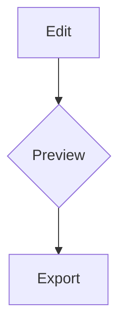

# MarkdownLive Sample

Some **bold**, *italic*, ~~strike~~, ==marked==, H~2~O, x^2^ and `inline code`. :rocket:

## Links

Visit https://example.com or [the docs](docs/readme.md) or jump to [Tasks](#tasks).

## Tasks

- [ ] open task
- [x] done task
- plain item
  1. nested one
  2. nested two

> [!NOTE]
> This is a GitHub alert.

| Left | Center | Right |
|:-----|:------:|------:|
| a    |   b    |     c |

```python
def hello(name: str) -> None:
    print(f"Hello {name}")  # comment
```

Inline math $e^{i\pi} + 1 = 0$ and a block:

$$
\int_0^1 x^2 \, dx = \frac{1}{3}
$$



 

Term
: Definition text

Footnote reference[^1].

<details><summary>More</summary>

Hidden <script>window.__pwned = true</script> content 

</details>

## Links

Duplicate heading above.

[^1]: The footnote.
